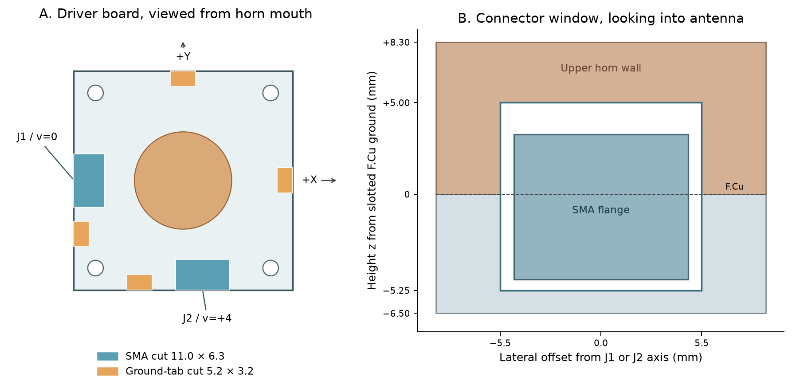

# Assemble the A04 antenna

Use one PCB of each type, two Amphenol RF 132415 Rev B SMA connectors, four M3 nonconductive fasteners and adjustable rigid dielectric stand-offs. The standard horn has an open back. Viewed from the horn mouth, J1 sits on the −X edge and J2 on the −Y edge. Positive Z points toward the mouth, and z = 0 is at the feed board's exposed slotted ground.

## Copper parts

The DXF CUT layer is the cut line and BEND marks the bend center. All dimensions are in millimeters.

| Part | Quantity | Material and dimensions |
|---|---:|---|
| [Positive horn wall](A04_horn_positive.dxf) | 2 | 0.30 mm copper, one +X and one +Y |
| [J1 horn wall](A04_horn_negative_X_J1.dxf) | 1 | 0.30 mm copper, −X, window centered on v = 0 |
| [J2 horn wall](A04_horn_negative_Y_J2.dxf) | 1 | 0.30 mm copper, −Y, window centered on v = +4.00 |
| [Horn ground tab](A04_ground_strap.dxf) | 4 | 0.10 mm soft copper, 4.00 wide, 2.50 mm inward leg, 3.00 mm upright leg, 0.25 mm inside bend radius |
| [SMA ground-jaw shim](A04_jaw_shim.dxf) | 4 | Tinned copper, 1.27 × 5.00, thickness selected on the bench |

The horn has a nominal 45.00 mm inner throat, 8.30 mm straight walls and a 65.00 mm mouth. Bend the flare out 45° with a 0.50 mm inside radius. Each SMA window is 11.00 mm wide and rises 5.00 mm above the slotted ground. Along the −X edge, v measures +Y. Along the −Y edge, v measures +X. Use the driver-board view to align the horn windows and tabs. The gray area below the ground plane in the connector view shows the envelope for an optional fixture. [Flat-pattern dimensions](geometry.json)

## Assembly order

1. Fit each SMA with its flat center tab against the B.Cu signal land. Align its datum B face to the PCB edge, allowing up to 0.10 mm setback toward the outside, and hold centering to ±0.20 mm. Check that both ground jaws on the signal side contact their lands. With the signal tab seated, measure the two gaps on the F.Cu side. Select one solid tinned-copper shim for each gap, allowing for the solder on both sides. The fitted height starts near 0.36 mm on a nominal board. Solder the grounds symmetrically and check continuity to the connector shells. Verify signal-to-ground and J1-to-J2 DC isolation. [132415 Rev B drawing](https://www.amphenolrf.com/en-us/assets/file/4065786574/)
2. Set the driver on the feed board with the driver copper facing the horn mouth. Check flange, jaw and solder clearance in the routed pockets. Fit and deburr each horn wall to the largest measured PCB width, with about 0.05–0.10 mm clearance per side for a dry fit. Close the four walls in a fixture and electrically join the corner seams.
3. Solder the four ground tabs from the horn walls to exposed F.Cu. The tab centers are at v = −11.00 on −X, v = −9.00 on −Y, and at the midpoint of the remaining two walls. Keep each tab and fillet within the corresponding driver cutout so the carrier rests flat against the feed board. Verify continuity to each wall.
4. Fit the parasitic patch copper-down toward the driver and support it on four dielectric stand-offs. Set the **patch copper-to-copper gap to 5.00 mm** with the boards parallel. Measure each copper height relative to the adjacent stand-off seat. The stand-off length equals 5.00 mm plus both signed copper heights. With bare seats and two 35 µm copper layers this is about 5.07 mm. Adjust for the actual finish, solder mask, and flatness.
5. For the optional 0.10 mm trial, add four equal low-loss insulating shims between the feed board and driver, clear of both H apertures and joints. This raises both patches by 0.10 mm and preserves their 5.00 mm copper gap. Record the resulting dimensions and retest both inputs. [VNA check](../validation/README.md)
